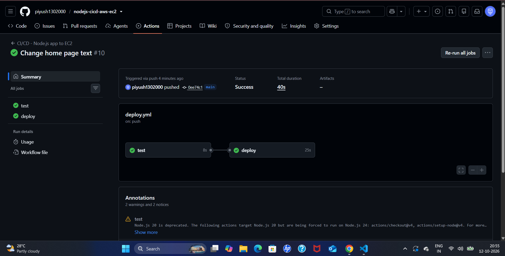
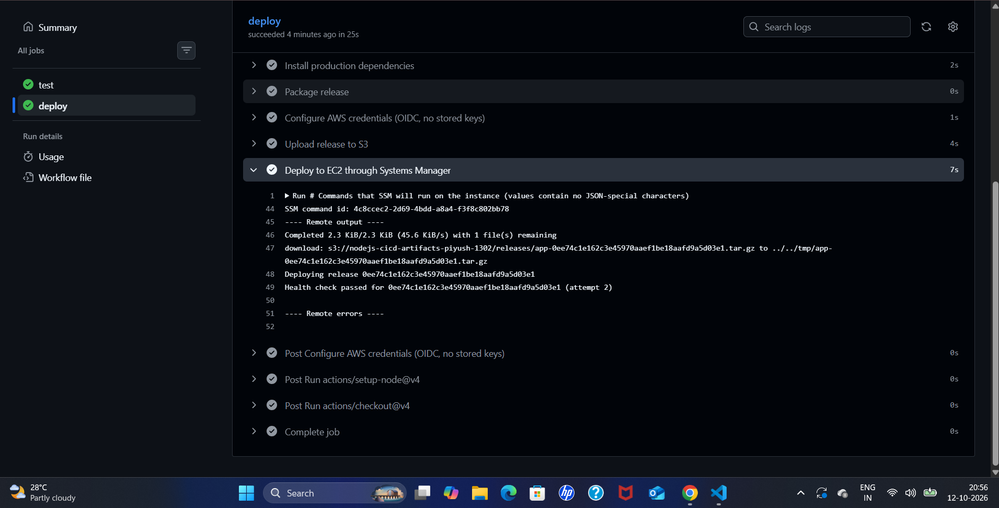
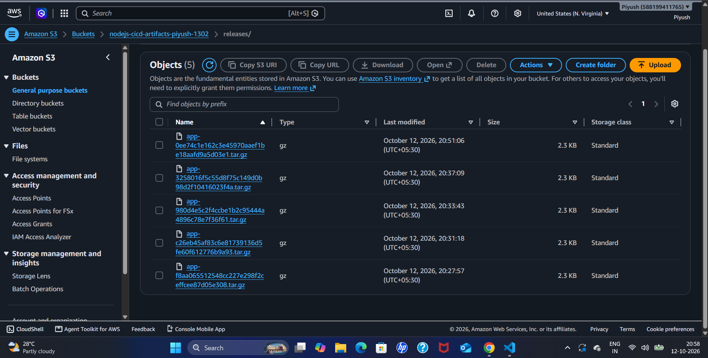
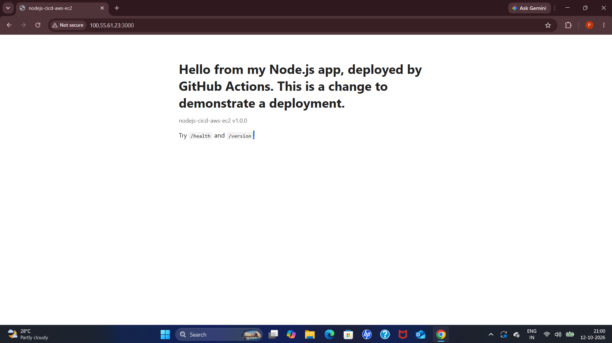

# Node.js CI/CD Pipeline to AWS EC2 with GitHub Actions

A working deployment pipeline for a small Node.js app. Every push to `main` is tested; if the tests pass, GitHub Actions packages the app, authenticates to AWS **without stored access keys**, ships the release to an EC2 instance, checks that it is healthy, and **rolls back automatically** if it is not. I then broke the pipeline on purpose in four different ways, diagnosed each failure from logs, and documented each one as a postmortem.

**Author:** Piyush Awasthi

**Related projects:** [AWS Incident Response Lab](https://github.com/piyush1302000/aws-incident-response-lab) (EC2 and CloudWatch) · [AWS VPC Troubleshooting Lab](https://github.com/piyush1302000/aws-vpc-troubleshooting-lab) (VPC networking)

---

## How it works

```
 git push to main
        |
        v
 GitHub Actions  (.github/workflows/deploy.yml)
 +------------------------------------------------------+
 | Job 1: test    npm ci, lint (if present), npm test   |
 | Job 2: deploy  runs only on main, only if tests pass |
 |   1. install production dependencies, build one      |
 |      release package named after the commit ID       |
 |   2. get temporary AWS credentials through OIDC      |
 |   3. upload the package to a private S3 bucket       |
 |   4. send a Systems Manager command to the instance  |
 +------------------------------------------------------+
        |
        v
 EC2 instance (Amazon Linux 2023)
   - downloads and unpacks the release into /opt/app/releases/<commit>
   - points /opt/app/current at the new release and restarts the service
   - calls /health for up to 30 seconds
   - healthy: done.  Not healthy: restores the previous release and fails the job
```

- **Pull requests** run only the tests; only pushes to `main` deploy.
- **Two deployments never run at once** (a `concurrency` group queues them).
- Each release is a folder named after its commit, and the last five are kept, so a manual rollback is just repointing a symlink.

---

## Design choices

| Choice | Why |
|---|---|
| **OIDC instead of AWS access keys** | GitHub proves its identity to AWS and receives credentials that expire in about an hour. Nothing secret is stored in GitHub. |
| **Role locked to one repository and branch** | The IAM trust policy only accepts tokens from the `main` branch of this repository. |
| **Systems Manager instead of SSH** | The instance has **no SSH port open**. The agent connects outward to AWS, and I get a shell through Session Manager when I need one. |
| **Least-privilege IAM** | The deploy role can upload to one folder of one bucket, run one command document on one instance, and read command results. The instance role can only read that folder. |
| **Build once, deploy the same artifact** | The package is built in CI and the exact same file is deployed. |
| **Health check and automatic rollback** | A release that passes its tests can still fail to start in production. The deploy script detects that and restores the previous release. |
| **Remote output printed in the pipeline log** | A failed deployment shows the server's health check result and app log in GitHub, so the cause is visible without logging in. |

---

## Baseline: a successful deployment

A push to `main` runs both jobs and deploys in about 40 seconds.

**Both jobs green:**



**The deploy job's step timings and the server's own output.** The remote output shows the release being downloaded from S3, deployed, and passing its health check:



**Each deployment is a separate release package in the private S3 bucket**, named after its commit:



**The deployed app in the browser:**



---

## Incident reports

Each incident was deliberately introduced, diagnosed from logs and AWS tools, fixed, and written up with a timeline and prevention steps.

| # | Failure injected | What happened | Key finding | Report |
|---|---|---|---|---|
| 1 | Health response changed so a test fails | The `test` job failed and `deploy` was skipped; production kept serving the previous release | A first attempt passed with **zero tests run** (`# tests 0`), so a green check mark only proves nothing failed, not that something was tested | [01-failing-test-blocks-release.md](postmortems/01-failing-test-blocks-release.md) |
| 2 | OIDC trust policy edited to a different branch | `deploy` failed at the AWS login step with `Not authorized to perform sts:AssumeRoleWithWebIdentity` | CloudTrail's event shows exactly what identity GitHub presented, which makes the mismatch obvious | [02-oidc-trust-policy-mismatch.md](postmortems/02-oidc-trust-policy-mismatch.md) |
| 3 | Startup crash added to `server.js` (tests still pass) | The release failed its health check and was rolled back automatically; the job went red | Passing tests do not prove a release will start; rollback limited the impact to about 30 seconds | [03-bad-release-health-check-rollback.md](postmortems/03-bad-release-health-check-rollback.md) |
| 4 | Port 3000 removed from the security group | The pipeline was **green** but the site timed out in the browser | The health check runs on the server, so it cannot see a firewall problem; Reachability Analyzer named the security group | [04-green-pipeline-unreachable-service.md](postmortems/04-green-pipeline-unreachable-service.md) |

---

## What I learned

- **A passing pipeline is only as strong as its checks.** The first attempt at incident 1 went green because no tests ran. Reading the test count in the log, not just the tick, is what exposed it.
- **OIDC failures are easy to diagnose when you compare both sides.** The GitHub log says AWS refused the token, and CloudTrail's **User name** field shows exactly what GitHub presented, to compare against the trust policy.
- **Tests and the real entry point are different things.** The tests loaded the app but not the server file, so a startup crash passed CI. The post-deploy health check and rollback caught what the tests could not.
- **Green does not mean reachable.** A health check on the server cannot see a firewall in front of it. The fix is a smoke test that requests the public address, the way a user would.
- **Useful logs shorten outages.** Printing the server's output into the pipeline log made each failure diagnosable from the browser within minutes.

---

## Security notes

- No AWS access keys are stored anywhere (OIDC only).
- The IAM role can be assumed only by this repository's `main` branch.
- No SSH access to the instance; shell access is through Session Manager.
- The releases bucket blocks all public access.
- The app listens on port 3000 over plain HTTP, which is acceptable for a lab but not for production (see below).

---

## Limitations and next steps

- **Single instance:** a failed release is briefly live before the rollback. A load balancer with rolling or blue/green deployments would remove that gap.
- **No HTTPS or custom domain.**
- **Smoke test not yet implemented:** a final pipeline step that requests the public URL would catch incident 4 automatically.
- **Stricter health check:** it currently requires an HTTP 200; it could also check the response body.
- **Infrastructure was created by hand.** Defining it in Terraform is the next step.

---

## Repository contents

```
├── .github/workflows/deploy.yml     the CI/CD workflow
├── deploy/remote-deploy.sh          runs on the server: switch release, health check, rollback
├── app.js, server.js                the Node.js app (no npm dependencies)
├── test/app.test.js                 tests, run with Node's built-in test runner
├── package.json, package-lock.json
├── postmortems/                     the four incident reports
└── screenshots/                     evidence used in this README and the reports
```

### Configuration the workflow expects

Repository **variables** (not secrets; no keys are used): `AWS_REGION`, `AWS_ROLE_ARN`, `S3_BUCKET`, `EC2_INSTANCE_ID`.

AWS side: a private S3 bucket, an EC2 instance with an instance role (`AmazonSSMManagedInstanceCore` plus read access to the bucket's `releases/` folder) and a security group opening only the app port, the GitHub OIDC identity provider, and a deploy role whose trust policy is limited to this repository's `main` branch.

---

## Skills demonstrated

GitHub Actions (CI/CD, job dependencies, concurrency, OIDC) · AWS IAM (OIDC identity provider, trust policies, least-privilege roles) · Amazon EC2 and S3 · AWS Systems Manager (Run Command, Session Manager) · AWS CloudTrail · VPC Reachability Analyzer · Linux and systemd · Bash scripting · Node.js testing · release management and rollback · incident diagnosis and postmortem writing
