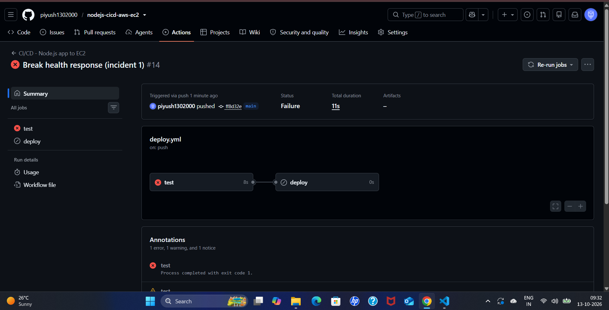
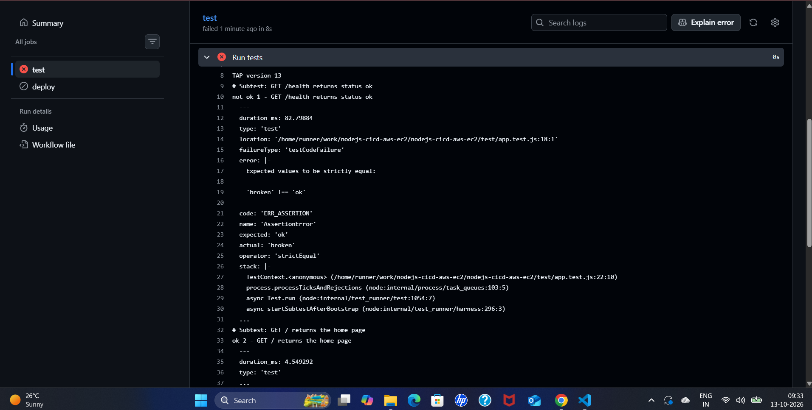
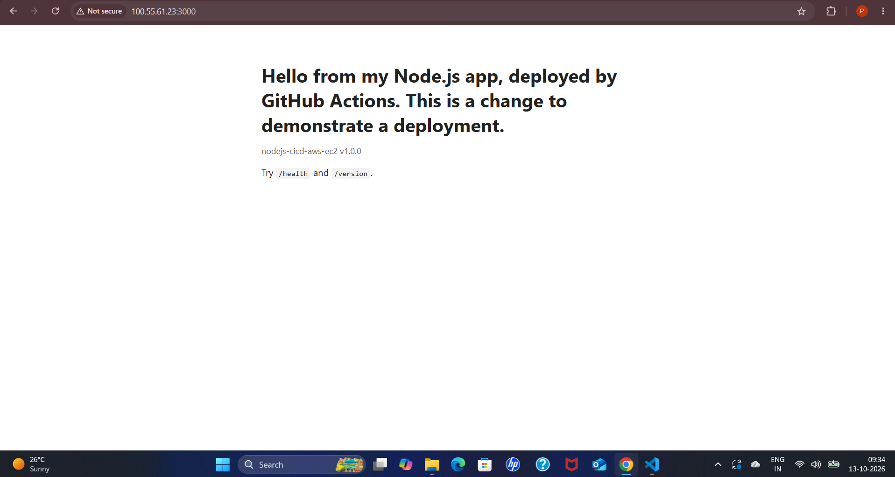
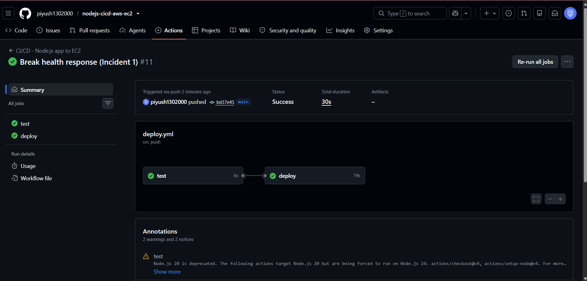
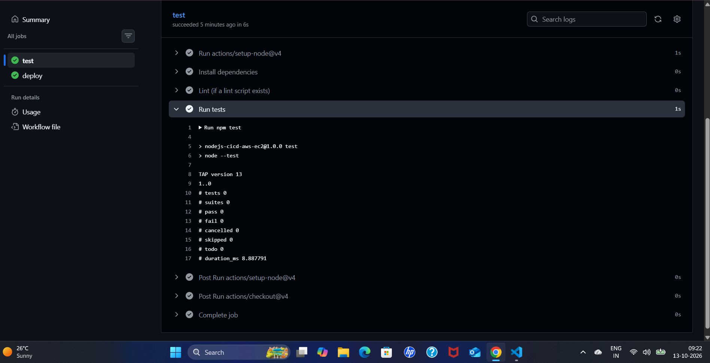
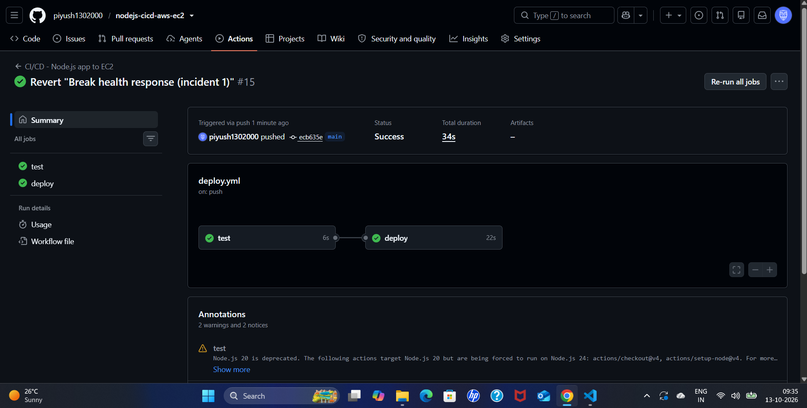

# CI/CD Incident Postmortem 1 — Failing Test Blocks the Release (Simulated)

**Author:** Piyush Awasthi
**Date:** 13 October 2026
**Environment:** GitHub Actions workflow `CI/CD - Node.js app to EC2` (`deploy.yml`), AWS `us-east-1` (EC2 `nodejs-app-server`, S3, Systems Manager), Node.js 22 sample app
**Severity:** SEV-3 — lab environment, no customer impact
**Status:** Resolved

---

## 1. Summary

To test the pipeline's quality gate, the `/health` response in `app.js` was changed from `{ status: 'ok' }` to `{ status: 'broken' }` and pushed to `main`. The `test` job failed on the assertion `'broken' !== 'ok'`, the `deploy` job was **skipped**, and the production site kept serving the previous release. Reverting the commit restored a green pipeline.

A first attempt a few minutes earlier had **passed**, because the test job ran **zero tests**. That false pass was the more important finding and is described in Section 4.

---

## 2. Timeline

| Time (UTC) | Event |
|---|---|
| ~03:47 (09:17 IST) | First attempt: push "Break health response (Incident 1)", run #11. Both jobs green; the test log reports `# tests 0` |
| Later | The missing `test` folder is added to the repository (exact time not recorded) |
| ~04:01 (09:31 IST) | Second attempt: push "Break health response (incident 1)", commit `ff8d32e`, run #14 |
| ~04:02 (09:32 IST) | Run #14 fails after 11 seconds. `test` fails (8 s), `deploy` is skipped |
| 04:03 (09:33 IST) | Failure log shows `'broken' !== 'ok'` in `test/app.test.js` |
| 04:04 (09:34 IST) | Site loads normally on the previous version |
| ~04:04 (09:34 IST) | Revert pushed, commit `ecb635e`, run #15 |
| By 04:05 (09:35 IST) | Run #15 green in 34 seconds (`test` 6 s, `deploy` 22 s) |

*IST times from the workstation clock were converted to UTC (IST = UTC+5:30).*

---

## 3. Detection

- **What alerted you?** The red cross on the run in the GitHub Actions tab, within seconds of the push.
- **Time to detect:** about 11 seconds, the full duration of the failed run. Nothing reached AWS.

**The failed run: `test` failed and `deploy` was skipped.**

---

## 4. Investigation

- **Failing step:** `Run tests` in the `test` job. The log shows:
  `not ok 1 - GET /health returns status ok`
  `Expected values to be strictly equal: 'broken' !== 'ok'` (expected `'ok'`, actual `'broken'`), at `test/app.test.js`. The other tests in the file passed, so the failure pointed to exactly one behaviour: the health response.

- **Why `deploy` never started:** the `deploy` job declares `needs: test`, so a failed `test` job skips it. Nothing was uploaded to S3 and no command was sent to the instance.
- **Production was untouched:** the site continued to serve the previous release.

- **The earlier false pass (run #11):** the first attempt with the same change finished green, and so did `deploy`. The `Run tests` log reported `# tests 0`, `# pass 0`. `node --test` found **no test files**, because the `test` folder had not been committed, and it still exited successfully. The broken build was therefore deployed. The deploy script's own health check did not stop it, because that check only requires an HTTP 200 and `/health` still answered with a 200 and different JSON.

- **Root cause (this incident):** a deliberate change to the health response, caught by the test.
- **Root cause (the false pass):** missing test files meant the gate had nothing to check. A passing `npm test` with zero tests proves nothing.

---

## 5. Resolution

- **Action taken:** `git revert` of the broken commit, then push to `main`.
- **For the false pass:** the missing `test` folder was added, after which the tests ran and caught the change.
- **Verification:** run #15 completed with both jobs green, and the site was still serving normally.

---

## 6. Impact

- **Demonstration run:** no production impact. The gate stopped the change before the deploy job started. The whole cycle from push to green revert took about 4 minutes.
- **First attempt (false pass):** the broken build was live from about 03:47 UTC until it was reverted (the exact time of that revert was not recorded). The site itself kept answering requests; only the content of `/health` was wrong.

---

## 7. Prevention / Follow-up Actions

- [ ] Fail the `test` job when no tests run, for example by checking that the output reports more than `# tests 0`, so a missing test folder cannot pass silently.
- [ ] Always run `npm test` locally and check the test count before pushing.
- [ ] Make the deploy health check read the response body (for example, require `"status":"ok"`) instead of only checking for HTTP 200.
- [ ] Enable branch protection so that a pull request cannot be merged unless the `test` check passes.

---

## 8. Lessons Learned

The pipeline did its job on the second attempt: a failing test stopped the release before anything touched the server. The first attempt taught the bigger lesson: a green check mark only means "nothing failed", not "something was tested". Reading the test count in the log (`# tests 0`) is what exposed it. A quality gate is only as good as the tests behind it, so the pipeline should verify that the gate actually ran. The `needs:` dependency is also what limited the damage in the successful case, because it prevented the deploy job from starting at all.
