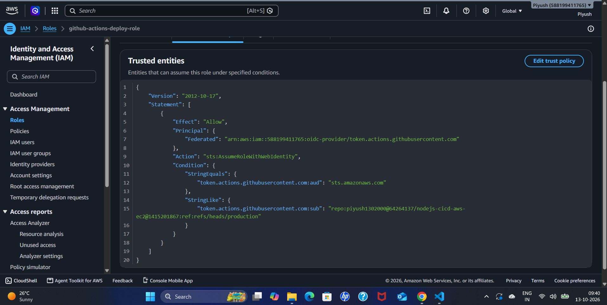
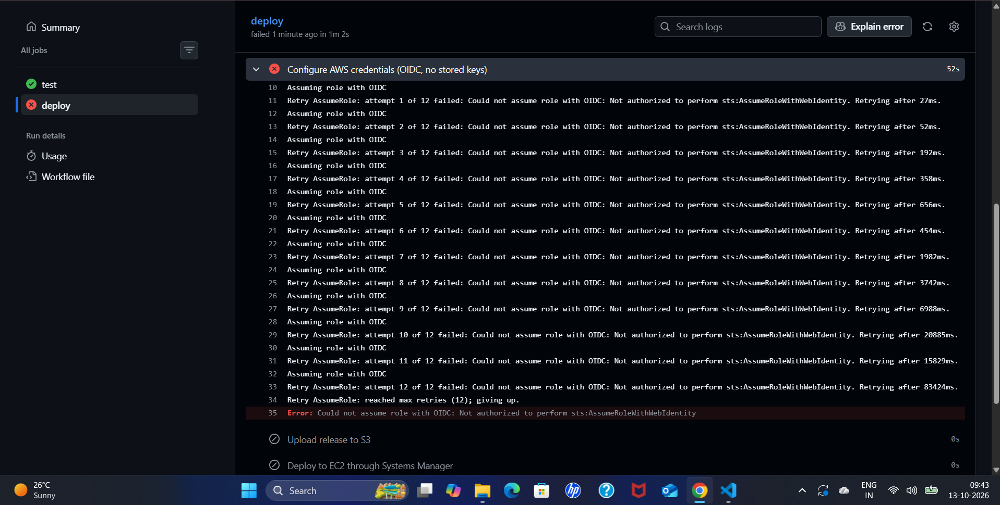
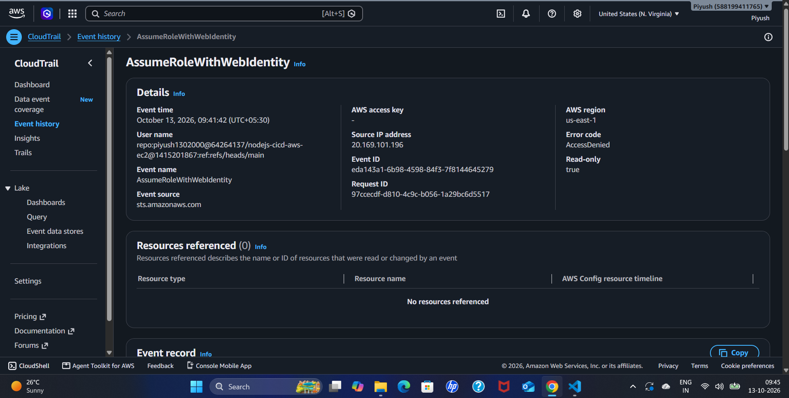
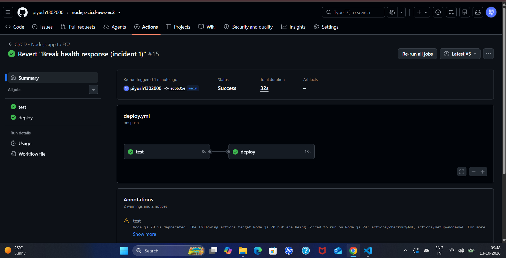

# CI/CD Incident Postmortem 2 — OIDC Trust Policy Does Not Match (Simulated)

**Author:** Piyush Awasthi
**Date:** 13 October 2026
**Environment:** GitHub Actions (`deploy` job), AWS IAM role `github-actions-deploy-role` with the GitHub OIDC identity provider, AWS CloudTrail, `us-east-1`
**Severity:** SEV-3 — lab environment, no customer impact
**Status:** Resolved

---

## 1. Summary

The trust policy of `github-actions-deploy-role` was edited so that only the `production` branch could assume it, while the workflow runs on `main`. The `test` job passed, but the `deploy` job failed at **Configure AWS credentials** with `Not authorized to perform sts:AssumeRoleWithWebIdentity`, so nothing reached S3 or the instance. CloudTrail showed the exact identity GitHub had presented (`...:ref:refs/heads/main`), which did not match the policy. Restoring `refs/heads/main` in the trust policy fixed the pipeline.

---

## 2. Timeline

| Time (UTC) | Event |
|---|---|
| Before 04:10 (09:40 IST) | Trust policy `sub` condition changed from `refs/heads/main` to `refs/heads/production` (exact time not recorded) |
| ~04:11 (09:41 IST) | Run #15 re-run (attempt 2) started |
| 04:11:42 (09:41:42 IST) | CloudTrail records `AssumeRoleWithWebIdentity` with error `AccessDenied` |
| ~04:12 (09:42 IST) | `deploy` job fails after 1 minute 2 seconds; `Configure AWS credentials` ran for 52 seconds |
| 04:15 (09:45 IST) | CloudTrail event reviewed |
| Before 04:17 | Trust policy restored to `refs/heads/main` (exact time not recorded) |
| ~04:17 (09:47 IST) | Run #15 re-run (attempt 3) started |
| By 04:18 (09:48 IST) | Attempt 3 succeeds in 32 seconds (`test` 8 s, `deploy` 18 s) |

*IST times from the workstation clock were converted to UTC (IST = UTC+5:30).*

---

## 3. Detection

- **What alerted you?** The `deploy` job turned red on the **Configure AWS credentials** step, while `test` stayed green.
- **Time to detect:** immediate, because the failure happens at the first AWS step. The step ran for 52 seconds before giving up because the action retries.

**The trust policy after the edit:** the `sub` condition names the `production` branch.

---

## 4. Investigation

- **The GitHub log:** the step logged `Assuming role with OIDC` and then, twelve times in a row:
  `Retry AssumeRole: attempt N of 12 failed: Could not assume role with OIDC: Not authorized to perform sts:AssumeRoleWithWebIdentity`,
  with delays growing from about 27 ms to over 20 seconds, ending with `reached max retries (12); giving up`. The `Upload release to S3` and `Deploy to EC2 through Systems Manager` steps were **skipped**, so nothing was uploaded and the server was untouched.

- **The AWS side (CloudTrail → Event history):** a `sts.amazonaws.com` event named `AssumeRoleWithWebIdentity`, error code `AccessDenied`, from a GitHub runner address, in `us-east-1`. Its **User name** field shows what GitHub presented as its identity:
  `repo:piyush1302000@<owner-id>/nodejs-cicd-aws-ec2@<repo-id>:ref:refs/heads/main`.

- **Comparison:** GitHub's token said `refs/heads/main`; the trust policy accepted only `refs/heads/production`. The `aud` condition (`sts.amazonaws.com`) was correct, so the mismatch was in `sub`.
- **Where the fault was:** the error came from AWS rejecting the token, not from GitHub failing to issue one. The workflow, the `id-token: write` permission, and the role ARN were all fine.
- **Root cause:** the role's trust policy `sub` condition did not match the branch the workflow ran on.

---

## 5. Resolution

- **Action taken:** restored `refs/heads/main` in the `sub` condition of the trust policy and re-ran the jobs.
- **Verification:** attempt 3 of the run completed with both jobs green, including the AWS steps.

---

## 6. Impact

- **Who/what was affected:** deployments only. The production site was not touched, because the job failed before any upload.
- **Duration:** about 8 minutes from the policy change (~04:10 UTC) to the successful re-run (~04:18 UTC).

---

## 7. Prevention / Follow-up Actions

- [ ] Manage the role and its trust policy as code (for example Terraform), so a change to the `sub` condition is reviewed before it is applied.
- [ ] Alert on repeated failed `AssumeRoleWithWebIdentity` events in CloudTrail, so an authentication break is noticed outside the pipeline run.
- [ ] Copy the `sub` value from the console's role wizard or from a CloudTrail event, instead of typing it by hand, because GitHub's token includes numeric owner and repository IDs in that value.
- [ ] Keep the condition as specific as possible (one repository, one branch or environment, no wildcards) so only the intended workflow can deploy.

---

## 8. Lessons Learned

OIDC trust conditions are strict by design, and that is the point: only the exact repository and branch in the policy can become the deploy role. The fastest diagnosis came from CloudTrail, whose **User name** field shows exactly what GitHub presented, which turns "why was I rejected" into a simple side-by-side comparison with the trust policy. The error text also tells you which side of the handshake failed: "Not authorized to perform sts:AssumeRoleWithWebIdentity" means AWS received a token and refused it. The action retries twelve times with growing delays, so an authentication misconfiguration costs about a minute per run and will not fix itself; reading the first error is quicker than waiting.
