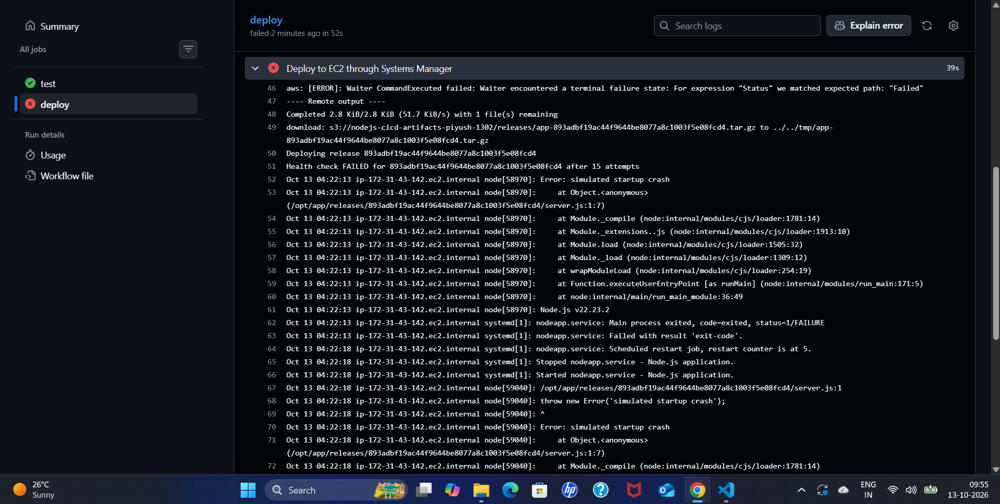
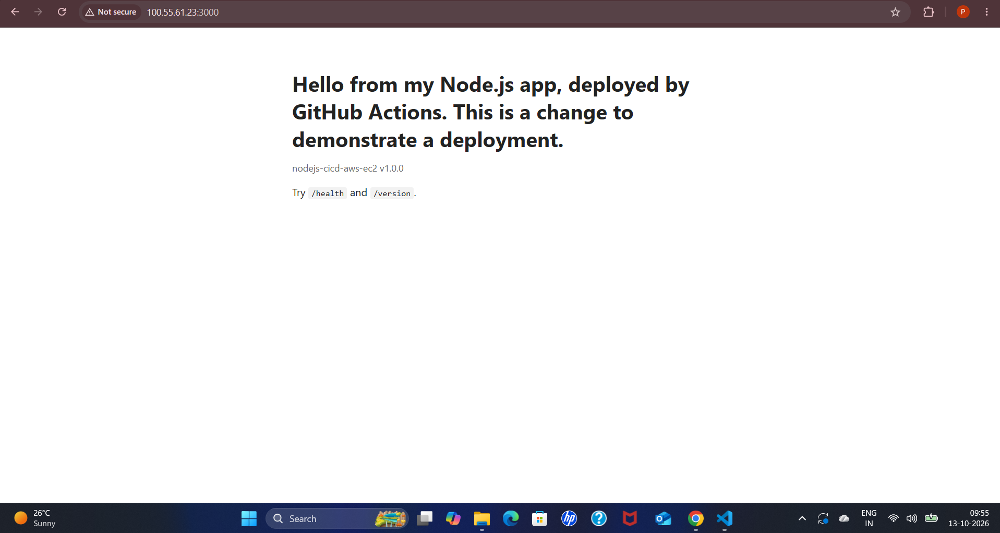
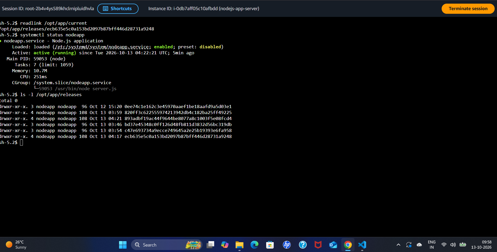
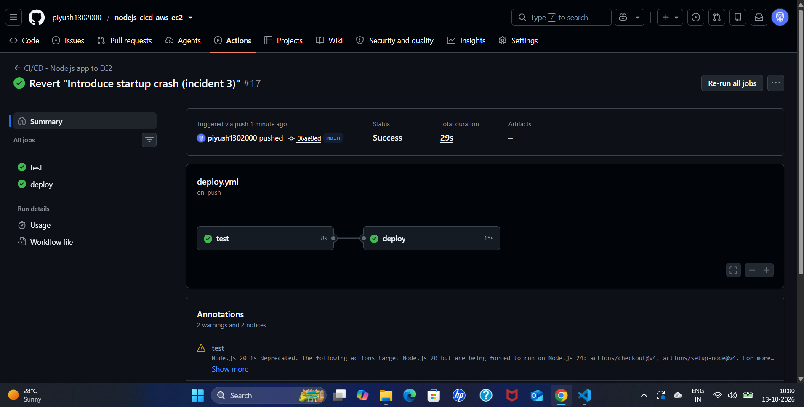

# CI/CD Incident Postmortem 3 — Bad Release Fails Its Health Check and Rolls Back (Simulated)

**Author:** Piyush Awasthi
**Date:** 13 October 2026
**Environment:** GitHub Actions (`deploy` job), EC2 `nodejs-app-server` (Amazon Linux 2023, systemd service `nodeapp`), S3 releases bucket, AWS Systems Manager, `us-east-1`
**Severity:** SEV-3 — lab environment, no customer impact
**Status:** Resolved

---

## 1. Summary

A line that throws an error was added at the top of `server.js` to simulate a release that passes its tests but cannot start in production. The tests passed because they import `app.js`, not `server.js`. The `deploy` job shipped the release, the new version crashed on startup, and the deploy script's health check failed after 15 attempts. The script restored the previous release and the job finished **red**. The server ended up running the previous good version. Reverting the commit produced a green run.

---

## 2. Timeline

| Time (UTC) | Event |
|---|---|
| ~04:21 (09:51 IST) | Crash commit pushed. `test` passes; `deploy` uploads release `893adbf` and unpacks it on the instance (release folder created 04:21) |
| 04:22:13 | Journal: `Error: simulated startup crash`; `nodeapp.service` exits with `status=1/FAILURE` |
| 04:22:18 | Journal: restart counter at 5, the service restarts and crashes again |
| 04:22:21 | Service restarted on the previous release (service shows `active (running)` since 04:22:21) |
| ~04:23 (09:53 IST) | `deploy` job ends red after 52 seconds. The Systems Manager step ran for 39 seconds |
| 04:25 (09:55 IST) | Browser check: site still loads on the previous version |
| 04:28 (09:58 IST) | Session Manager: `current` points to the previous release; service running; failed release still on disk |
| ~04:30 (10:00 IST) | Revert pushed. Run #17 green in 29 seconds (`test` 8 s, `deploy` 15 s) |

*IST times from the workstation clock were converted to UTC (IST = UTC+5:30).*

---

## 3. Detection

- **What alerted you?** The `deploy` job turned red at the **Deploy to EC2 through Systems Manager** step, while `test` was green.
- **Time to detect:** about 2 minutes from the push, which is the upload, the unpack, and the 30-second health check window.

**The failing deploy step, with the remote output printed into the Actions log:**

---

## 4. Investigation

- **What the Actions log showed:** the step failed with `Waiter CommandExecuted failed ... matched expected path: "Failed"`, followed by the **Remote output** from the instance:
  - `Deploying release 893adbf19ac4...`
  - `Health check FAILED for 893adbf19ac4... after 15 attempts`
  - the last lines of the app's log: `Error: simulated startup crash` at `/opt/app/releases/893adbf.../server.js:1:7`
  - systemd messages: `Main process exited, code=exited, status=1/FAILURE`, `Failed with result 'exit-code'`, `Scheduled restart job, restart counter is at 5`

  The cause (the error text, the file, and the line) was visible in the pipeline log itself, without logging in to the server. The log excerpt captured ends before the rollback messages, so the rollback is confirmed from the server's state instead (below).

- **Production was serving the previous version:** the browser still loaded the home page from the earlier release.

- **Server state (Session Manager):**
  - `readlink /opt/app/current` points to the **previous** release (`ecb635e...`), not to the failed one.
  - `systemctl status nodeapp` shows `active (running)` since 04:22:21 UTC, running `node server.js`.
  - `ls -l /opt/app/releases` still lists the failed release `893adbf...`, so it is available for inspection.

- **Why the pipeline did not catch it earlier:** the tests import `app.js` and never load `server.js`, where the crash was. That gap is exactly why a health check after deployment is needed.
- **Root cause:** the release threw an error on startup, so the service could not stay up and `/health` never answered.

---

## 5. Resolution

- **Automatic mitigation:** after 15 failed health checks (about 30 seconds) the deploy script pointed `current` back to the previous release, cleared the failed state, and restarted the service. It then ended with an error so the pipeline turned red.
- **Permanent fix:** `git revert` of the crash commit and a push to `main`.
- **Verification:** run #17 completed with both jobs green.

---

## 6. Impact

- **Who/what was affected:** while the failed release was live and crash-looping (the health check window of roughly 30 seconds, ending at 04:22:21 UTC), requests to the app would have failed. After the rollback the site served the previous version normally.
- **Duration of degraded state:** about 30 seconds. On a single instance, a rollback limits the damage but does not remove it.

---

## 7. Prevention / Follow-up Actions

- [ ] Add a test that starts `server.js` (a startup smoke test), so a crash on startup is caught before deployment.
- [ ] Run more than one instance behind a load balancer with rolling or blue/green deployments, so a failed release never serves traffic during the health check.
- [ ] Make the health check stricter: confirm the response body as well as the HTTP status.
- [ ] Alert when a deployment fails and rolls back, so someone investigates even though users are unaffected.

---

## 8. Lessons Learned

Passing tests do not prove a release will start in production. Here the tests and the real entry point were separate, and the crash lived in the part the tests never loaded. The health check and automatic rollback turned a bad deploy into a short blip instead of an outage that lasts until someone notices. Printing the server's output and logs into the pipeline log made the cause visible within a minute and from the browser alone. The remaining weakness is that the broken release was briefly live; that is a limit of a single-instance design.
