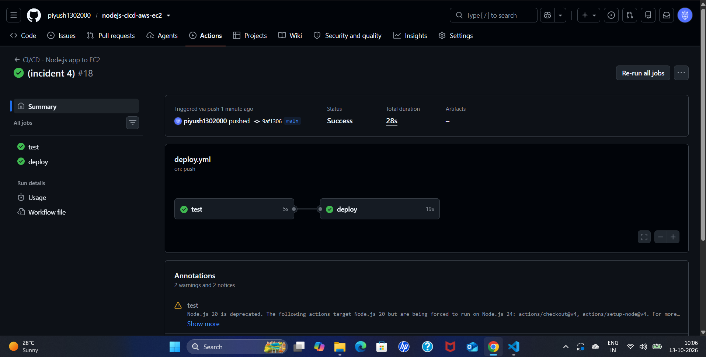
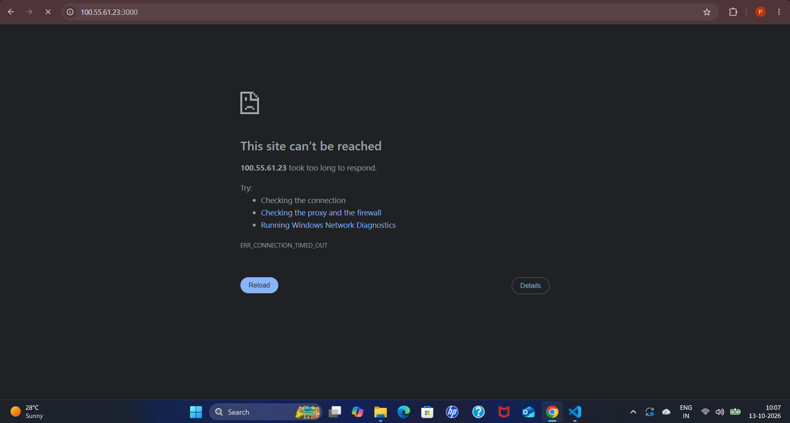
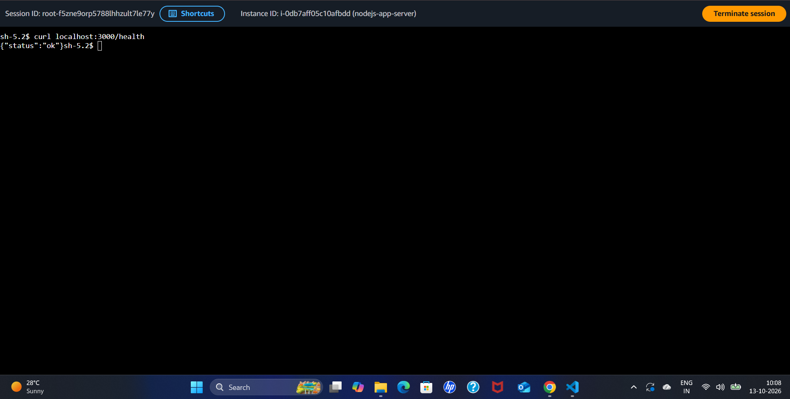
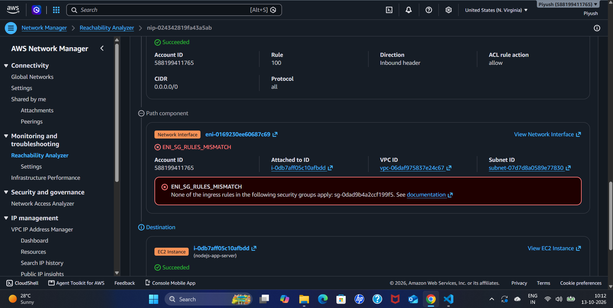
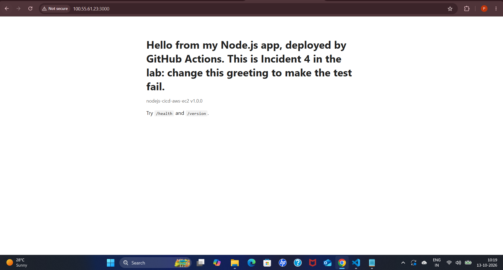

# CI/CD Incident Postmortem 4 — Green Pipeline, Unreachable Site (Simulated)

**Author:** Piyush Awasthi
**Date:** 13 October 2026
**Environment:** GitHub Actions (`deploy` job), EC2 `nodejs-app-server` in the default VPC, security group `nodeapp-sg`, AWS Systems Manager Session Manager, VPC Reachability Analyzer, `us-east-1`
**Severity:** SEV-3 — lab environment, no customer impact
**Status:** Resolved

---

## 1. Summary

The inbound rule for TCP port 3000 was removed from the instance's security group, and a small change was pushed. The pipeline finished **fully green**, but the website timed out in the browser. From inside the instance, `/health` still answered, so the application and the deployment were healthy. Reachability Analyzer showed that the security group had no ingress rule matching the traffic. Re-adding the rule restored access.

---

## 2. Timeline

| Time (UTC) | Event |
|---|---|
| Before 04:36 (10:06 IST) | Inbound TCP 3000 rule removed from `nodeapp-sg` (exact time not recorded) |
| ~04:35 (10:05 IST) | Small change pushed (commit `9af1306`), run #18 |
| ~04:36 (10:06 IST) | Run #18 finishes green in 28 seconds (`test` 5 s, `deploy` 19 s) |
| 04:37 (10:07 IST) | Browser: `ERR_CONNECTION_TIMED_OUT` |
| 04:38 (10:08 IST) | Session Manager: `curl localhost:3000/health` returns `{"status":"ok"}` |
| 04:42 (10:12 IST) | Reachability Analyzer reports `ENI_SG_RULES_MISMATCH` for `nodeapp-sg` |
| Before 04:49 | Inbound TCP 3000 rule restored (exact time not recorded) |
| 04:49 (10:19 IST) | Browser loads the site, showing the new text from run #18 |

*IST times from the workstation clock were converted to UTC (IST = UTC+5:30).*

---

## 3. Detection

- **What alerted you?** A manual browser check after the pipeline went green. No automated check covered the public address.
- **Time to detect:** about 1 minute after the green run, because the check was deliberate. In a real environment nothing would have alerted anyone, since the pipeline reported success.

**The pipeline reports success:**

**The browser times out:**

---

## 4. Investigation

- **Reading the symptom:** a timeout means packets are being silently dropped between the internet and the instance. A refused connection would instead mean the packet arrived and nothing was listening.
- **Application and deployment checked from inside the instance:** in Session Manager, `curl localhost:3000/health` returned `{"status":"ok"}`. The app was running and healthy, so the fault was not in the deployment.

- **Why the pipeline stayed green:** the deploy script's health check calls `localhost` on the instance, so it can only see problems inside the machine. It cannot see a firewall between users and the instance.
- **Reachability Analyzer** (internet gateway to `nodejs-app-server`, TCP 3000): the network ACL allowed the traffic (rule 100), and the path failed at the instance's network interface:
  `ENI_SG_RULES_MISMATCH — None of the ingress rules in the following security groups apply: sg-0dad9b4a2ccf199f5` (the `nodeapp-sg` group).

- **Root cause:** the inbound rule for TCP 3000 was missing from `nodeapp-sg`. Security groups deny any inbound traffic that no rule allows, so every connection to port 3000 was dropped.

---

## 5. Resolution

- **Action taken:** re-added the inbound rule to `nodeapp-sg`: Custom TCP, port 3000, source `0.0.0.0/0`.
- **Verification:** the site loaded in the browser and showed the greeting from the latest deployment.

---

## 6. Impact

- **Who/what was affected:** all external access to the app on port 3000. Internal access and the application itself were unaffected.
- **Duration:** at least about 13 minutes (from the green run at 04:36 UTC to confirmed recovery at 04:49 UTC). The exact time the rule was removed was not recorded.

---

## 7. Prevention / Follow-up Actions

- [ ] Add a smoke test as the last step of the `deploy` job that requests the public URL from the runner (for example `http://<public IP>:3000/health`) and fails the job if it is not reachable. This was identified as the fix but was not implemented in this exercise.
- [ ] Manage the security group as code (for example Terraform) so a removed rule shows up in review.
- [ ] Alert on `RevokeSecurityGroupIngress` events in CloudTrail for production groups.
- [ ] Keep a saved Reachability Analyzer path from the internet to the app, so triage takes one run.

---

## 8. Lessons Learned

A green pipeline is not the same as a working service. The pipeline proved that the code was tested, delivered, and healthy on the instance, but not that users could reach it. The fastest way to split the problem was to compare two checks: `localhost` worked and the browser timed out, which placed the fault between the internet and the instance. Reachability Analyzer then named the exact component. This is the same troubleshooting path as in the VPC lab, applied to a pipeline. The lasting fix is to test through the same path users take, so the pipeline fails the moment the site becomes unreachable.
